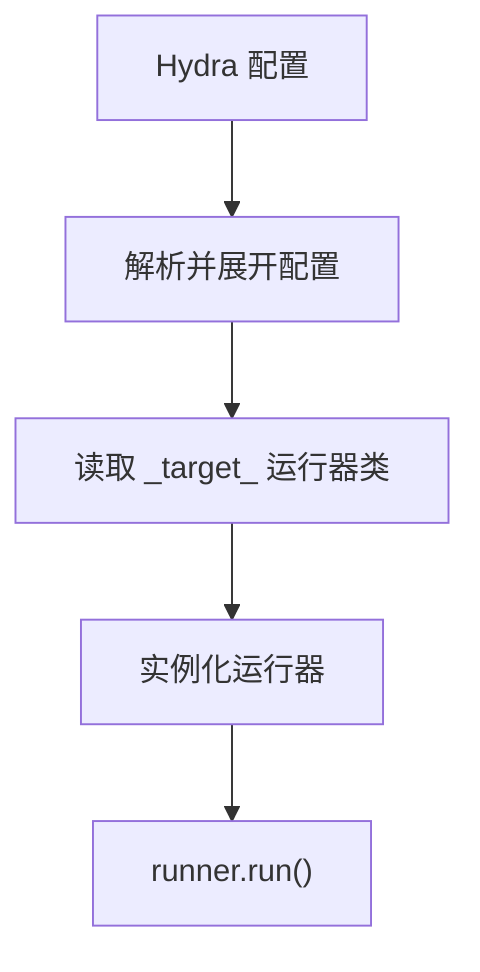

<!-- PAGE_ID: ode-policy_01_overview -->

📚 Relevant source files

以下源码文件用于生成本页：

- [README.md:5-7](https://github.com/NTUMARS/ODE-POLICY/blob/7482a1fc56332e2c3318ba3eb3d0b92adda9a469/README.md#L5-L7)
- [README.md:26-48](https://github.com/NTUMARS/ODE-POLICY/blob/7482a1fc56332e2c3318ba3eb3d0b92adda9a469/README.md#L26-L48)
- [README.md:274-294](https://github.com/NTUMARS/ODE-POLICY/blob/7482a1fc56332e2c3318ba3eb3d0b92adda9a469/README.md#L274-L294)
- [pyproject.toml:5-37](https://github.com/NTUMARS/ODE-POLICY/blob/7482a1fc56332e2c3318ba3eb3d0b92adda9a469/pyproject.toml#L5-L37)
- [train.py:17-28](https://github.com/NTUMARS/ODE-POLICY/blob/7482a1fc56332e2c3318ba3eb3d0b92adda9a469/ode_policy/train.py#L17-L28)

# 项目概览

> **相关页面**：[[安装与复现实验|02_getting_started.md]]、[[训练流程与运行器|03_training.md]]

---

<!-- BEGIN:AUTOGEN ode-policy_01_overview_purpose -->
## 项目定位与能力范围

ODE Policy 是面向机器人模仿学习的策略实现。项目以动作动力学为方法主题，当前 `main` 分支包含 ODE policy、多个模仿学习基线，以及 LIBERO、LIBERO-plus 和 2D 多模态导航相关实现；其他机器人、VLA 与强化学习实现被维护在各自分支，不属于本页描述的 `main` 范围。（[README.md:5-7](https://github.com/NTUMARS/ODE-POLICY/blob/7482a1fc56332e2c3318ba3eb3d0b92adda9a469/README.md#L5-L7)；[README.md:36-48](https://github.com/NTUMARS/ODE-POLICY/blob/7482a1fc56332e2c3318ba3eb3d0b92adda9a469/README.md#L36-L48)）

README 记载，当前默认配置将本体状态作为观测条件，并把离散夹爪信号作为 ODE 的渐变状态积分，而发送给环境的夹爪命令仍保持离散。默认求解器为 Euler；文档同时指出可通过配置切换 RK4，以复现论文设置。（[README.md:26-34](https://github.com/NTUMARS/ODE-POLICY/blob/7482a1fc56332e2c3318ba3eb3d0b92adda9a469/README.md#L26-L34)）

项目以 Python `>=3.10` 为运行版本要求，直接依赖涵盖 PyTorch、Hydra、NumPy、Zarr、SciPy 等；完整仿真环境（如 robosuite、MuJoCo 和 LIBERO）的安装由单独环境脚本处理，不应仅凭此依赖列表推断其已包含于 Python 包依赖中。（[pyproject.toml:5-37](https://github.com/NTUMARS/ODE-POLICY/blob/7482a1fc56332e2c3318ba3eb3d0b92adda9a469/pyproject.toml#L5-L37)）

Sources: [README.md:5-7](https://github.com/NTUMARS/ODE-POLICY/blob/7482a1fc56332e2c3318ba3eb3d0b92adda9a469/README.md#L5-L7), [README.md:26-48](https://github.com/NTUMARS/ODE-POLICY/blob/7482a1fc56332e2c3318ba3eb3d0b92adda9a469/README.md#L26-L48), [pyproject.toml:5-37](https://github.com/NTUMARS/ODE-POLICY/blob/7482a1fc56332e2c3318ba3eb3d0b92adda9a469/pyproject.toml#L5-L37)
<!-- END:AUTOGEN ode-policy_01_overview_purpose -->

---

<!-- BEGIN:AUTOGEN ode-policy_01_overview_entrypoints -->
## 入口与代码边界

`ode_policy/train.py` 是 Hydra 训练入口：它解析并展开配置，读取配置中的 `_target_` 来取得运行器类，使用配置构造运行器实例，随后调用 `run()` 启动执行。（[train.py:17-28](https://github.com/NTUMARS/ODE-POLICY/blob/7482a1fc56332e2c3318ba3eb3d0b92adda9a469/ode_policy/train.py#L17-L28)）

README 中的目录说明将策略与基线放在 `policies/`，将策略配置放在 `configs/policy_config/`；LIBERO 目录涵盖数据转换、环境封装、训练运行器和评测器，`nav2d/` 对应 2D 导航任务。`datasets/`、`utils/` 与 `runners/` 承担数据集、编码器、归一化和检查点等共用职责；脚本和文档分别承载环境/数据/训练/评测操作及复现、移植资料。（[README.md:274-294](https://github.com/NTUMARS/ODE-POLICY/blob/7482a1fc56332e2c3318ba3eb3d0b92adda9a469/README.md#L274-L294)）

Sources: [train.py:17-28](https://github.com/NTUMARS/ODE-POLICY/blob/7482a1fc56332e2c3318ba3eb3d0b92adda9a469/ode_policy/train.py#L17-L28), [README.md:274-294](https://github.com/NTUMARS/ODE-POLICY/blob/7482a1fc56332e2c3318ba3eb3d0b92adda9a469/README.md#L274-L294)
<!-- END:AUTOGEN ode-policy_01_overview_entrypoints -->

---
