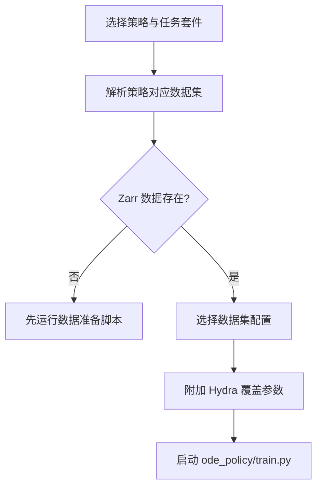

<!-- PAGE_ID: ode-policy_02_getting-started -->
<details>
<summary>相关源码</summary>

- [README.md](https://github.com/NTUMARS/ODE-POLICY/blob/7482a1fc56332e2c3318ba3eb3d0b92adda9a469/README.md)
- [setup_env.sh](https://github.com/NTUMARS/ODE-POLICY/blob/7482a1fc56332e2c3318ba3eb3d0b92adda9a469/scripts/setup_env.sh)
- [REPRODUCE.md](https://github.com/NTUMARS/ODE-POLICY/blob/7482a1fc56332e2c3318ba3eb3d0b92adda9a469/docs/REPRODUCE.md)
- [train_libero.sh](https://github.com/NTUMARS/ODE-POLICY/blob/7482a1fc56332e2c3318ba3eb3d0b92adda9a469/scripts/train_libero.sh)

</details>

# 安装与复现实验

> **相关页面**：[[训练流程与运行器|03_training.md]]、[[LIBERO 与 LIBERO-Plus 评测|06_libero.md]]

---

<!-- BEGIN:AUTOGEN ode-policy_02_getting-started_environment -->
## 环境与依赖

复现脚本面向 Linux/Conda 环境，默认创建 Python 3.10 的 `ode_policy` 环境，并按配置安装 PyTorch、MuJoCo、robosuite、LIBERO 和项目训练依赖。安装脚本中的版本约束有兼容性原因，例如固定 Zarr 2.x 以匹配 ReplayBuffer 使用的 API；不建议在复现实验前随意升级关键依赖。([setup_env.sh:1-20](https://github.com/NTUMARS/ODE-POLICY/blob/7482a1fc56332e2c3318ba3eb3d0b92adda9a469/scripts/setup_env.sh#L1-L20))

```bash
bash scripts/setup_env.sh
conda activate ode_policy
bash scripts/prepare_libero_data.sh
```

环境脚本还设置 LIBERO 资源路径、检查 Torch/CUDA、Zarr 与 benchmark 导入；需要可用的 Conda、兼容的 CUDA 构建以及 LIBERO 数据资产。([setup_env.sh:22-48](https://github.com/NTUMARS/ODE-POLICY/blob/7482a1fc56332e2c3318ba3eb3d0b92adda9a469/scripts/setup_env.sh#L22-L48), [setup_env.sh:97-158](https://github.com/NTUMARS/ODE-POLICY/blob/7482a1fc56332e2c3318ba3eb3d0b92adda9a469/scripts/setup_env.sh#L97-L158))

Sources: [setup_env.sh:1-20](https://github.com/NTUMARS/ODE-POLICY/blob/7482a1fc56332e2c3318ba3eb3d0b92adda9a469/scripts/setup_env.sh#L1-L20), [setup_env.sh:22-48](https://github.com/NTUMARS/ODE-POLICY/blob/7482a1fc56332e2c3318ba3eb3d0b92adda9a469/scripts/setup_env.sh#L22-L48), [setup_env.sh:97-158](https://github.com/NTUMARS/ODE-POLICY/blob/7482a1fc56332e2c3318ba3eb3d0b92adda9a469/scripts/setup_env.sh#L97-L158)
<!-- END:AUTOGEN ode-policy_02_getting-started_environment -->

---

<!-- BEGIN:AUTOGEN ode-policy_02_getting-started_training -->
## 启动训练与配置覆盖

LIBERO 启动脚本接收策略名、可选任务套件和 Hydra 覆盖参数。默认套件是四套任务联合训练的 `libero_4suite`；脚本根据策略家族选择 Zarr 数据路径，并在缺少数据时明确要求先准备数据。([train_libero.sh:4-20](https://github.com/NTUMARS/ODE-POLICY/blob/7482a1fc56332e2c3318ba3eb3d0b92adda9a469/scripts/train_libero.sh#L4-L20), [train_libero.sh:29-50](https://github.com/NTUMARS/ODE-POLICY/blob/7482a1fc56332e2c3318ba3eb3d0b92adda9a469/scripts/train_libero.sh#L29-L50))

```bash
bash scripts/train_libero.sh ode
bash scripts/train_libero.sh fm_dit libero_4suite train_config.training_params.seed=0
```



脚本根据策略自动选择普通或 KNN 数据集配置，也可以通过 `ZARR`、`ODE_ZARR` 和额外 Hydra 参数覆盖默认值。对照论文配置时应使用仓库提供的 `docs/REPRODUCE.md` 命令，因为当前 ODE 默认值已为跨数据稳健性做过调整。([train_libero.sh:38-64](https://github.com/NTUMARS/ODE-POLICY/blob/7482a1fc56332e2c3318ba3eb3d0b92adda9a469/scripts/train_libero.sh#L38-L64), [train_libero.sh:66-94](https://github.com/NTUMARS/ODE-POLICY/blob/7482a1fc56332e2c3318ba3eb3d0b92adda9a469/scripts/train_libero.sh#L66-L94))

Sources: [train_libero.sh:4-20](https://github.com/NTUMARS/ODE-POLICY/blob/7482a1fc56332e2c3318ba3eb3d0b92adda9a469/scripts/train_libero.sh#L4-L20), [train_libero.sh:29-64](https://github.com/NTUMARS/ODE-POLICY/blob/7482a1fc56332e2c3318ba3eb3d0b92adda9a469/scripts/train_libero.sh#L29-L64)
<!-- END:AUTOGEN ode-policy_02_getting-started_training -->

---

<!-- BEGIN:AUTOGEN ode-policy_02_getting-started_reproduction -->
## 论文配置复现

论文复现指南规定了共同协议：四套 LIBERO 任务联合训练、AdamW 与余弦学习率计划、相同视觉/语言编码器、固定初始状态评测，并明确说明 ODE 求解器和策略参数需要覆盖成论文设置。训练和评测最好分配到不同 GPU，避免评测显著拖慢训练。([REPRODUCE.md:6-23](https://github.com/NTUMARS/ODE-POLICY/blob/7482a1fc56332e2c3318ba3eb3d0b92adda9a469/docs/REPRODUCE.md#L6-L23))

以 ODE 策略为例，复现实验命令会显式指定 RK4、论文使用的状态条件路径与夹爪配置；不要仅依赖 ODE 当前默认配置。复现指南还按 E1-E7 区分收敛、执行质量、数据效率、随机种子和推理开销等实验。([REPRODUCE.md:31-48](https://github.com/NTUMARS/ODE-POLICY/blob/7482a1fc56332e2c3318ba3eb3d0b92adda9a469/docs/REPRODUCE.md#L31-L48))

Sources: [REPRODUCE.md:6-23](https://github.com/NTUMARS/ODE-POLICY/blob/7482a1fc56332e2c3318ba3eb3d0b92adda9a469/docs/REPRODUCE.md#L6-L23), [REPRODUCE.md:31-48](https://github.com/NTUMARS/ODE-POLICY/blob/7482a1fc56332e2c3318ba3eb3d0b92adda9a469/docs/REPRODUCE.md#L31-L48)
<!-- END:AUTOGEN ode-policy_02_getting-started_reproduction -->

---
