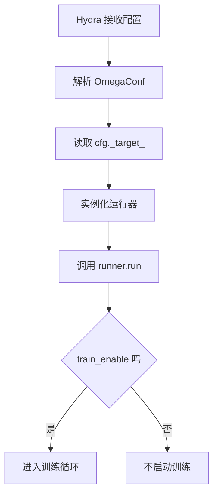
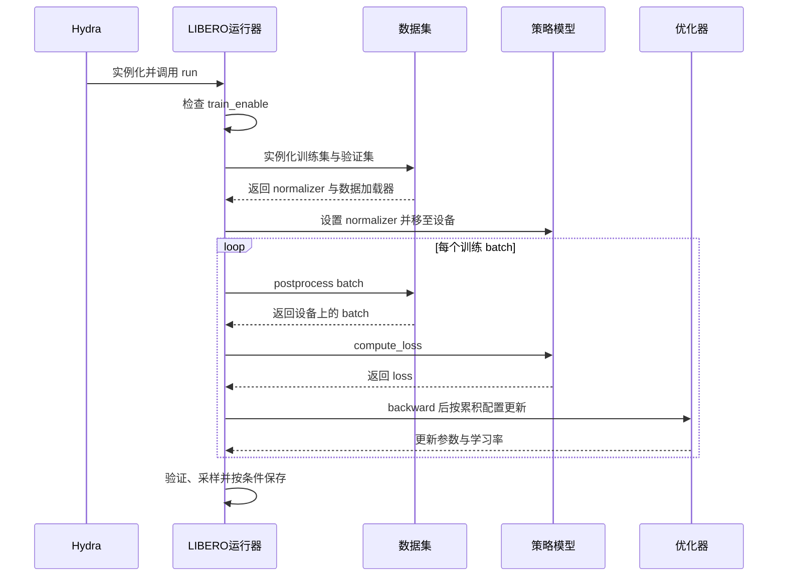

<!-- PAGE_ID: ode-policy_03_training -->

Relevant source files

本页依据以下源码生成，引用固定到提交 `7482a1fc56332e2c3318ba3eb3d0b92adda9a469`：

- [train.py:13-28](https://github.com/NTUMARS/ODE-POLICY/blob/7482a1fc56332e2c3318ba3eb3d0b92adda9a469/ode_policy/train.py#L13-L28)
- [base_runner.py:12-67](https://github.com/NTUMARS/ODE-POLICY/blob/7482a1fc56332e2c3318ba3eb3d0b92adda9a469/ode_policy/runners/base_runner.py#L12-L67)
- [default_train.yaml:1-68](https://github.com/NTUMARS/ODE-POLICY/blob/7482a1fc56332e2c3318ba3eb3d0b92adda9a469/ode_policy/configs/train_config/default_train.yaml#L1-L68)
- [ode.yaml:9-73](https://github.com/NTUMARS/ODE-POLICY/blob/7482a1fc56332e2c3318ba3eb3d0b92adda9a469/ode_policy/configs/policy_config/ode.yaml#L9-L73)
- [libero_train_runner.py:72-147](https://github.com/NTUMARS/ODE-POLICY/blob/7482a1fc56332e2c3318ba3eb3d0b92adda9a469/ode_policy/libero/libero_train_runner.py#L72-L147)
- [libero_train_runner.py:187-244](https://github.com/NTUMARS/ODE-POLICY/blob/7482a1fc56332e2c3318ba3eb3d0b92adda9a469/ode_policy/libero/libero_train_runner.py#L187-L244)
- [libero_train_runner.py:246-337](https://github.com/NTUMARS/ODE-POLICY/blob/7482a1fc56332e2c3318ba3eb3d0b92adda9a469/ode_policy/libero/libero_train_runner.py#L246-L337)

# 训练流程与运行器

> **相关页面**：[[ODE Policy 与流匹配|04_ode_policy.md]]、[[数据集与预处理|05_data.md]]

---

<!-- BEGIN:AUTOGEN ode-policy_03_training_config-resolution -->
## 配置解析与对象构建

训练入口由 Hydra 装饰的 `main(cfg)` 接收配置，先解析 OmegaConf 插值，再从 `cfg._target_` 取得运行器类并实例化，最后调用 `runner.run()`；`eval` resolver 在 Hydra 入口定义前注册，可供配置插值使用（[train.py:13-24](https://github.com/NTUMARS/ODE-POLICY/blob/7482a1fc56332e2c3318ba3eb3d0b92adda9a469/ode_policy/train.py#L13-L24)）。

LIBERO 运行器在构造时用 `cfg.policy_config` 实例化策略，并按 `use_ema` 决定是否复制 EMA 模型；优化器则从 `cfg.train_config.optimizer` 实例化并接收策略参数（[libero_train_runner.py:72-95](https://github.com/NTUMARS/ODE-POLICY/blob/7482a1fc56332e2c3318ba3eb3d0b92adda9a469/ode_policy/libero/libero_train_runner.py#L72-L95)）。默认 ODE 策略目标为 `ODEImagePolicy`，其观测编码器配置使用多图像编码器和 ResNet-18；默认向量场为 4 层、宽度 1732 的 MLP，求解器为 Euler，子步数为 1（[ode.yaml:9-39](https://github.com/NTUMARS/ODE-POLICY/blob/7482a1fc56332e2c3318ba3eb3d0b92adda9a469/ode_policy/configs/policy_config/ode.yaml#L9-L39)）。

`LiberoTrainRunner.run()` 仅在 `cfg.train_enable` 为真时调用 `train()`，因此入口完成通用配置解析和运行器构建后，具体训练启停仍由配置控制（[libero_train_runner.py:335-337](https://github.com/NTUMARS/ODE-POLICY/blob/7482a1fc56332e2c3318ba3eb3d0b92adda9a469/ode_policy/libero/libero_train_runner.py#L335-L337)）。

Sources: [train.py:13-24](https://github.com/NTUMARS/ODE-POLICY/blob/7482a1fc56332e2c3318ba3eb3d0b92adda9a469/ode_policy/train.py#L13-L24), [libero_train_runner.py:72-95](https://github.com/NTUMARS/ODE-POLICY/blob/7482a1fc56332e2c3318ba3eb3d0b92adda9a469/ode_policy/libero/libero_train_runner.py#L72-L95), [ode.yaml:9-39](https://github.com/NTUMARS/ODE-POLICY/blob/7482a1fc56332e2c3318ba3eb3d0b92adda9a469/ode_policy/configs/policy_config/ode.yaml#L9-L39)
<!-- END:AUTOGEN ode-policy_03_training_config-resolution -->

---

<!-- BEGIN:AUTOGEN ode-policy_03_training-run-loop -->
## 训练循环、优化与检查点

默认训练配置指定 `cuda:0`、随机种子 42、100 个 epoch、AdamW（学习率 `1e-4`）和 batch size 32；梯度累积默认为 1，EMA 默认开启。验证和采样每 5 个 epoch 执行一次，检查点默认每 10 个 epoch 保存（[default_train.yaml:1-28](https://github.com/NTUMARS/ODE-POLICY/blob/7482a1fc56332e2c3318ba3eb3d0b92adda9a469/ode_policy/configs/train_config/default_train.yaml#L1-L28)、[default_train.yaml:41-68](https://github.com/NTUMARS/ODE-POLICY/blob/7482a1fc56332e2c3318ba3eb3d0b92adda9a469/ode_policy/configs/train_config/default_train.yaml#L41-L68)）。`stop_at_epoch` 可提前结束实际运行而保留由 `num_epochs` 决定的学习率计划；配置注释说明 `max_train_steps` 默认应保持为空，以免每个 epoch 截短但调度器仍按完整数据遍历估算训练步数（[default_train.yaml:10-16](https://github.com/NTUMARS/ODE-POLICY/blob/7482a1fc56332e2c3318ba3eb3d0b92adda9a469/ode_policy/configs/train_config/default_train.yaml#L10-L16)、[default_train.yaml:29-37](https://github.com/NTUMARS/ODE-POLICY/blob/7482a1fc56332e2c3318ba3eb3d0b92adda9a469/ode_policy/configs/train_config/default_train.yaml#L29-L37)）。

运行器在训练开始时可从最新检查点恢复，并可按 `reset_epoch_on_resume` 清零 epoch 和全局步数；随后实例化训练集与验证集、取得 normalizer 并设置到策略和 EMA 模型。学习率调度器的总训练步数按 `len(train_dataloader) * num_epochs / gradient_accumulate_every` 计算（[libero_train_runner.py:97-147](https://github.com/NTUMARS/ODE-POLICY/blob/7482a1fc56332e2c3318ba3eb3d0b92adda9a469/ode_policy/libero/libero_train_runner.py#L97-L147)）。

每个训练 batch 经数据集 `postprocess` 后传入 `model.compute_loss`；损失按累积步数缩放并反向传播，运行器按全局步数与累积配置决定何时更新优化器、清空梯度并推进调度器。启用 EMA 时，每个 batch 后都会更新 EMA；训练损失及全局步数、epoch 和学习率写入 JSON 日志，模型提供 `_last_metrics` 时也合并这些指标（[libero_train_runner.py:187-244](https://github.com/NTUMARS/ODE-POLICY/blob/7482a1fc56332e2c3318ba3eb3d0b92adda9a469/ode_policy/libero/libero_train_runner.py#L187-L244)）。

运行器按 `val_every` 执行验证，按 `sample_every` 用训练 batch 进行动作预测并记录 MSE；检查点由显式 `checkpoint_epochs` 列表或 `checkpoint_every` 控制，并且最后一个配置 epoch 也会保存。检查点 payload 包含可序列化的配置、具备 `state_dict` 的对象状态，以及 `include_keys` 指定的对象；LIBERO runner 将 `global_step` 和 `epoch` 纳入 pickled 字段（[libero_train_runner.py:246-321](https://github.com/NTUMARS/ODE-POLICY/blob/7482a1fc56332e2c3318ba3eb3d0b92adda9a469/ode_policy/libero/libero_train_runner.py#L246-L321)、[libero_train_runner.py:72-74](https://github.com/NTUMARS/ODE-POLICY/blob/7482a1fc56332e2c3318ba3eb3d0b92adda9a469/ode_policy/libero/libero_train_runner.py#L72-L74)、[base_runner.py:30-67](https://github.com/NTUMARS/ODE-POLICY/blob/7482a1fc56332e2c3318ba3eb3d0b92adda9a469/ode_policy/runners/base_runner.py#L30-L67)）。

Sources: [default_train.yaml:1-37](https://github.com/NTUMARS/ODE-POLICY/blob/7482a1fc56332e2c3318ba3eb3d0b92adda9a469/ode_policy/configs/train_config/default_train.yaml#L1-L37), [libero_train_runner.py:97-147](https://github.com/NTUMARS/ODE-POLICY/blob/7482a1fc56332e2c3318ba3eb3d0b92adda9a469/ode_policy/libero/libero_train_runner.py#L97-L147), [libero_train_runner.py:187-321](https://github.com/NTUMARS/ODE-POLICY/blob/7482a1fc56332e2c3318ba3eb3d0b92adda9a469/ode_policy/libero/libero_train_runner.py#L187-L321), [base_runner.py:30-67](https://github.com/NTUMARS/ODE-POLICY/blob/7482a1fc56332e2c3318ba3eb3d0b92adda9a469/ode_policy/runners/base_runner.py#L30-L67)
<!-- END:AUTOGEN ode-policy_03_training-run-loop -->

---

<!-- BEGIN:AUTOGEN ode-policy_03_training_lifecycle -->
## LIBERO 训练运行器

`LiberoTrainRunner` 继承 `BaseRunner`。它先建立策略、可选的 EMA 副本和优化器；进入 `train()` 后构建训练与验证数据加载器，传递 normalizer 和数据集提供的可选统计量，再把模型、EMA 模型和优化器移动到配置指定设备（[libero_train_runner.py:72-95](https://github.com/NTUMARS/ODE-POLICY/blob/7482a1fc56332e2c3318ba3eb3d0b92adda9a469/ode_policy/libero/libero_train_runner.py#L72-L95)、[libero_train_runner.py:110-171](https://github.com/NTUMARS/ODE-POLICY/blob/7482a1fc56332e2c3318ba3eb3d0b92adda9a469/ode_policy/libero/libero_train_runner.py#L110-L171)）。

`BaseRunner` 定义 `train`、`evaluate` 和 `run` 接口占位，由子类实现；同时提供检查点保存与恢复机制。LIBERO runner 的 `run()` 将配置开关连接到训练流程，训练完成或提前停止时按配置记录日志、递增 epoch，并在满足条件时写入检查点（[base_runner.py:12-28](https://github.com/NTUMARS/ODE-POLICY/blob/7482a1fc56332e2c3318ba3eb3d0b92adda9a469/ode_policy/runners/base_runner.py#L12-L28)、[libero_train_runner.py:301-337](https://github.com/NTUMARS/ODE-POLICY/blob/7482a1fc56332e2c3318ba3eb3d0b92adda9a469/ode_policy/libero/libero_train_runner.py#L301-L337)）。

Sources: [libero_train_runner.py:72-95](https://github.com/NTUMARS/ODE-POLICY/blob/7482a1fc56332e2c3318ba3eb3d0b92adda9a469/ode_policy/libero/libero_train_runner.py#L72-L95), [libero_train_runner.py:110-171](https://github.com/NTUMARS/ODE-POLICY/blob/7482a1fc56332e2c3318ba3eb3d0b92adda9a469/ode_policy/libero/libero_train_runner.py#L110-L171), [libero_train_runner.py:187-244](https://github.com/NTUMARS/ODE-POLICY/blob/7482a1fc56332e2c3318ba3eb3d0b92adda9a469/ode_policy/libero/libero_train_runner.py#L187-L244), [libero_train_runner.py:301-337](https://github.com/NTUMARS/ODE-POLICY/blob/7482a1fc56332e2c3318ba3eb3d0b92adda9a469/ode_policy/libero/libero_train_runner.py#L301-L337)
<!-- END:AUTOGEN ode-policy_03_training_lifecycle -->

---
