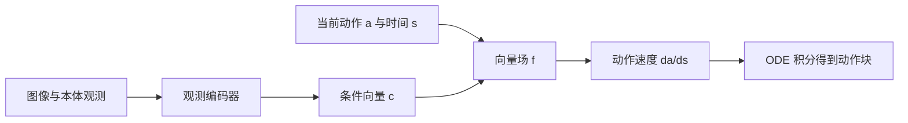

<!-- PAGE_ID: ode-policy_04_ode-policy -->

相关源码

- [ode_image_policy.py](https://github.com/NTUMARS/ODE-POLICY/blob/7482a1fc56332e2c3318ba3eb3d0b92adda9a469/ode_policy/policies/ode/ode_image_policy.py)
- [flow_matchers.py](https://github.com/NTUMARS/ODE-POLICY/blob/7482a1fc56332e2c3318ba3eb3d0b92adda9a469/ode_policy/utils/flow/flow_matchers.py)
- [mean_flow_matcher.py](https://github.com/NTUMARS/ODE-POLICY/blob/7482a1fc56332e2c3318ba3eb3d0b92adda9a469/ode_policy/utils/flow/mean_flow_matcher.py)
- [ode.yaml](https://github.com/NTUMARS/ODE-POLICY/blob/7482a1fc56332e2c3318ba3eb3d0b92adda9a469/ode_policy/configs/policy_config/ode.yaml)

# ODE Policy 与流匹配

> **相关页面**：[[训练流程与运行器|03_training.md]]、[[数据集与预处理|05_data.md]]

---

<!-- BEGIN:AUTOGEN ode-policy_04_ode-policy_policy-interface -->
## 策略输入输出与动作分块

`ODEImagePolicy` 是图像策略实现：它继承基础图像策略，接收观测字典与可选起始动作，预测一个动作轨迹，并在推理结果中返回动作块。实现参数包括观测步数、动作步数、动作维度、速度场网络、ODE 求解器和归一化器。([ode_image_policy.py:162-194](https://github.com/NTUMARS/ODE-POLICY/blob/7482a1fc56332e2c3318ba3eb3d0b92adda9a469/ode_policy/policies/ode/ode_image_policy.py#L162-L194), [ode_image_policy.py:433-460](https://github.com/NTUMARS/ODE-POLICY/blob/7482a1fc56332e2c3318ba3eb3d0b92adda9a469/ode_policy/policies/ode/ode_image_policy.py#L433-L460))

LIBERO 的 ODE 配置将动作拆为末端位姿与夹爪维度；策略可以把夹爪作为连续积分状态，再在执行端将状态转为离散命令。配置默认采用 Euler，论文配置则显式指定 RK4 等参数。([ode.yaml:1-8](https://github.com/NTUMARS/ODE-POLICY/blob/7482a1fc56332e2c3318ba3eb3d0b92adda9a469/ode_policy/configs/policy_config/ode.yaml#L1-L8), [ode.yaml:37-73](https://github.com/NTUMARS/ODE-POLICY/blob/7482a1fc56332e2c3318ba3eb3d0b92adda9a469/ode_policy/configs/policy_config/ode.yaml#L37-L73))

Sources: [ode_image_policy.py:162-194](https://github.com/NTUMARS/ODE-POLICY/blob/7482a1fc56332e2c3318ba3eb3d0b92adda9a469/ode_policy/policies/ode/ode_image_policy.py#L162-L194), [ode_image_policy.py:433-460](https://github.com/NTUMARS/ODE-POLICY/blob/7482a1fc56332e2c3318ba3eb3d0b92adda9a469/ode_policy/policies/ode/ode_image_policy.py#L433-L460), [ode.yaml:37-73](https://github.com/NTUMARS/ODE-POLICY/blob/7482a1fc56332e2c3318ba3eb3d0b92adda9a469/ode_policy/configs/policy_config/ode.yaml#L37-L73)
<!-- END:AUTOGEN ode-policy_04_ode-policy_policy-interface -->

---

<!-- BEGIN:AUTOGEN ode-policy_04_ode-policy_velocity-field -->
## 速度场网络与条件信息

策略将图像观测编码为条件向量，并将当前动作状态与时间变量送入向量场。MLP 版本使用 FiLM 层调制隐藏表示；另有 DiT 风格向量场实现。配置控制本体状态进入观测条件还是直接进入场，以及网络宽度、深度和求解器。([ode_image_policy.py:82-116](https://github.com/NTUMARS/ODE-POLICY/blob/7482a1fc56332e2c3318ba3eb3d0b92adda9a469/ode_policy/policies/ode/ode_image_policy.py#L82-L116), [ode_image_policy.py:118-160](https://github.com/NTUMARS/ODE-POLICY/blob/7482a1fc56332e2c3318ba3eb3d0b92adda9a469/ode_policy/policies/ode/ode_image_policy.py#L118-L160), [ode_image_policy.py:313-333](https://github.com/NTUMARS/ODE-POLICY/blob/7482a1fc56332e2c3318ba3eb3d0b92adda9a469/ode_policy/policies/ode/ode_image_policy.py#L313-L333))

速度场只负责给定动作状态和积分时间的导数；策略的 `integrate` 方法负责选择固定步长数值求解器，并在每一步调用该场。([ode_image_policy.py:327-376](https://github.com/NTUMARS/ODE-POLICY/blob/7482a1fc56332e2c3318ba3eb3d0b92adda9a469/ode_policy/policies/ode/ode_image_policy.py#L327-L376))

DiT 风格的轨迹网络由 `FlowTransformer` 等模块实现，ODE-DiT 配置将其注入同一策略接口；通用匹配器抽象则约定训练损失和采样方法，ConsistencyFlowMatcher 提供一致性损失与分段采样实现。([flow_net.py:112-180](https://github.com/NTUMARS/ODE-POLICY/blob/7482a1fc56332e2c3318ba3eb3d0b92adda9a469/ode_policy/utils/models/flow_net.py#L112-L180), [ode_dit.yaml:12-40](https://github.com/NTUMARS/ODE-POLICY/blob/7482a1fc56332e2c3318ba3eb3d0b92adda9a469/ode_policy/configs/policy_config/ode_dit.yaml#L12-L40), [base_flow_matcher.py:1-6](https://github.com/NTUMARS/ODE-POLICY/blob/7482a1fc56332e2c3318ba3eb3d0b92adda9a469/ode_policy/utils/flow/base_flow_matcher.py#L1-L6), [consistency_flow_matcher.py:8-33](https://github.com/NTUMARS/ODE-POLICY/blob/7482a1fc56332e2c3318ba3eb3d0b92adda9a469/ode_policy/utils/flow/consistency_flow_matcher.py#L8-L33))

Sources: [ode_image_policy.py:82-160](https://github.com/NTUMARS/ODE-POLICY/blob/7482a1fc56332e2c3318ba3eb3d0b92adda9a469/ode_policy/policies/ode/ode_image_policy.py#L82-L160), [ode_image_policy.py:313-376](https://github.com/NTUMARS/ODE-POLICY/blob/7482a1fc56332e2c3318ba3eb3d0b92adda9a469/ode_policy/policies/ode/ode_image_policy.py#L313-L376)
<!-- END:AUTOGEN ode-policy_04_ode-policy_velocity-field -->

---

<!-- BEGIN:AUTOGEN ode-policy_04_ode-policy_training-sampling -->
## 训练目标与数值积分采样

训练时，策略从归一化动作序列中抽取历史状态和目标动作段，依据配置计算轨迹损失；夹爪可采用 ODE 状态损失，也可通过单独的分类 logits 计算 BCE。([ode_image_policy.py:520-569](https://github.com/NTUMARS/ODE-POLICY/blob/7482a1fc56332e2c3318ba3eb3d0b92adda9a469/ode_policy/policies/ode/ode_image_policy.py#L520-L569))

求解器支持 Euler、显式中点 RK2 与 RK4；这些离散积分步骤直接作用于速度场。论文复现实验要求覆盖默认求解器设置，而日常默认配置选择 Euler。([ode_image_policy.py:334-376](https://github.com/NTUMARS/ODE-POLICY/blob/7482a1fc56332e2c3318ba3eb3d0b92adda9a469/ode_policy/policies/ode/ode_image_policy.py#L334-L376), [REPRODUCE.md:18-20](https://github.com/NTUMARS/ODE-POLICY/blob/7482a1fc56332e2c3318ba3eb3d0b92adda9a469/docs/REPRODUCE.md#L18-L20))

流匹配模块提供多种匹配器：普通路径匹配器通过底层 `torchcfm` loss 和 ODE 求解器采样；MeanFlow 匹配器有独立的训练损失与采样逻辑，作为不同训练目标实现，而不是 ODEImagePolicy 固定步骤积分的别名。([flow_matchers.py:11-79](https://github.com/NTUMARS/ODE-POLICY/blob/7482a1fc56332e2c3318ba3eb3d0b92adda9a469/ode_policy/utils/flow/flow_matchers.py#L11-L79), [mean_flow_matcher.py:37-144](https://github.com/NTUMARS/ODE-POLICY/blob/7482a1fc56332e2c3318ba3eb3d0b92adda9a469/ode_policy/utils/flow/mean_flow_matcher.py#L37-L144))

ConsistencyFlowMatcher 在共享接口下实现独立的分段损失与采样器。([consistency_flow_matcher.py:33-119](https://github.com/NTUMARS/ODE-POLICY/blob/7482a1fc56332e2c3318ba3eb3d0b92adda9a469/ode_policy/utils/flow/consistency_flow_matcher.py#L33-L119))

Sources: [ode_image_policy.py:334-376](https://github.com/NTUMARS/ODE-POLICY/blob/7482a1fc56332e2c3318ba3eb3d0b92adda9a469/ode_policy/policies/ode/ode_image_policy.py#L334-L376), [ode_image_policy.py:520-569](https://github.com/NTUMARS/ODE-POLICY/blob/7482a1fc56332e2c3318ba3eb3d0b92adda9a469/ode_policy/policies/ode/ode_image_policy.py#L520-L569), [flow_matchers.py:11-79](https://github.com/NTUMARS/ODE-POLICY/blob/7482a1fc56332e2c3318ba3eb3d0b92adda9a469/ode_policy/utils/flow/flow_matchers.py#L11-L79), [mean_flow_matcher.py:37-144](https://github.com/NTUMARS/ODE-POLICY/blob/7482a1fc56332e2c3318ba3eb3d0b92adda9a469/ode_policy/utils/flow/mean_flow_matcher.py#L37-L144)
<!-- END:AUTOGEN ode-policy_04_ode-policy_training-sampling -->

---
