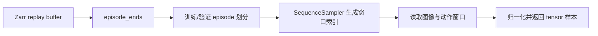

<!-- PAGE_ID: ode-policy_05_data -->

相关源码

- [robot_image_dataset.py](https://github.com/NTUMARS/ODE-POLICY/blob/7482a1fc56332e2c3318ba3eb3d0b92adda9a469/ode_policy/datasets/robot_image_dataset.py)
- [sampler.py](https://github.com/NTUMARS/ODE-POLICY/blob/7482a1fc56332e2c3318ba3eb3d0b92adda9a469/ode_policy/utils/sampler.py)
- [replay_buffer.py](https://github.com/NTUMARS/ODE-POLICY/blob/7482a1fc56332e2c3318ba3eb3d0b92adda9a469/ode_policy/utils/replay_buffer.py)
- [normalizer.py](https://github.com/NTUMARS/ODE-POLICY/blob/7482a1fc56332e2c3318ba3eb3d0b92adda9a469/ode_policy/utils/normalizer.py)
- [libero_dataset.py](https://github.com/NTUMARS/ODE-POLICY/blob/7482a1fc56332e2c3318ba3eb3d0b92adda9a469/ode_policy/libero/libero_dataset.py)
- [robot_image_dataset_knn.py](https://github.com/NTUMARS/ODE-POLICY/blob/7482a1fc56332e2c3318ba3eb3d0b92adda9a469/ode_policy/datasets/robot_image_dataset_knn.py)
- [hdf5_to_zarr.py](https://github.com/NTUMARS/ODE-POLICY/blob/7482a1fc56332e2c3318ba3eb3d0b92adda9a469/ode_policy/libero/hdf5_to_zarr.py)

# 数据集与预处理

> **相关页面**：[[训练流程与运行器|03_training.md]]、[[ODE Policy 与流匹配|04_ode_policy.md]]

---

<!-- BEGIN:AUTOGEN ode-policy_05_data_storage -->
## 数据存储与加载

图像机器人数据集以 Zarr replay buffer 作为逐步数据存储，并用 episode 结束索引保留轨迹边界。`RobotImageDataset` 初始化时读取回放缓冲区、划分训练/验证 episode，并根据时间窗口长度构造 `SequenceSampler`。([robot_image_dataset.py:19-70](https://github.com/NTUMARS/ODE-POLICY/blob/7482a1fc56332e2c3318ba3eb3d0b92adda9a469/ode_policy/datasets/robot_image_dataset.py#L19-L70), [replay_buffer.py:88-110](https://github.com/NTUMARS/ODE-POLICY/blob/7482a1fc56332e2c3318ba3eb3d0b92adda9a469/ode_policy/utils/replay_buffer.py#L88-L110))

采样器按 episode 范围构造时间序列索引，并允许窗口越过 episode 边界时使用 padding，而不会把相邻 episode 拼成一条轨迹。([sampler.py:9-48](https://github.com/NTUMARS/ODE-POLICY/blob/7482a1fc56332e2c3318ba3eb3d0b92adda9a469/ode_policy/utils/sampler.py#L9-L48), [sampler.py:82-124](https://github.com/NTUMARS/ODE-POLICY/blob/7482a1fc56332e2c3318ba3eb3d0b92adda9a469/ode_policy/utils/sampler.py#L82-L124))

Sources: [robot_image_dataset.py:19-70](https://github.com/NTUMARS/ODE-POLICY/blob/7482a1fc56332e2c3318ba3eb3d0b92adda9a469/ode_policy/datasets/robot_image_dataset.py#L19-L70), [sampler.py:9-48](https://github.com/NTUMARS/ODE-POLICY/blob/7482a1fc56332e2c3318ba3eb3d0b92adda9a469/ode_policy/utils/sampler.py#L9-L48), [replay_buffer.py:88-110](https://github.com/NTUMARS/ODE-POLICY/blob/7482a1fc56332e2c3318ba3eb3d0b92adda9a469/ode_policy/utils/replay_buffer.py#L88-L110)
<!-- END:AUTOGEN ode-policy_05_data_storage -->

---

<!-- BEGIN:AUTOGEN ode-policy_05_data_sample -->
## 样本结构与动作窗口

每个样本由时间窗口内的观测字典和动作张量构成；图像观测按键组织，动作保持时间维度，供策略按 `n_obs_steps` 和 `horizon` 读取。数据集的 `__getitem__` 通过采样器索引取出窗口，对图像布局做变换，并将 NumPy 数据转换为 PyTorch 张量。([base_dataset.py:31-51](https://github.com/NTUMARS/ODE-POLICY/blob/7482a1fc56332e2c3318ba3eb3d0b92adda9a469/ode_policy/datasets/base_dataset.py#L31-L51), [robot_image_dataset.py:96-142](https://github.com/NTUMARS/ODE-POLICY/blob/7482a1fc56332e2c3318ba3eb3d0b92adda9a469/ode_policy/datasets/robot_image_dataset.py#L96-L142))

LIBERO 数据集扩展基础机器人图像数据集，可按配置添加 wrist camera、task embedding 以及历史动作等额外观测信号；其归一化器会为任务嵌入使用 identity 映射，并按需添加额外字段归一化。([libero_dataset.py:56-69](https://github.com/NTUMARS/ODE-POLICY/blob/7482a1fc56332e2c3318ba3eb3d0b92adda9a469/ode_policy/libero/libero_dataset.py#L56-L69), [libero_dataset.py:143-176](https://github.com/NTUMARS/ODE-POLICY/blob/7482a1fc56332e2c3318ba3eb3d0b92adda9a469/ode_policy/libero/libero_dataset.py#L143-L176))

KNN 数据集扩展普通图像数据集，预计算邻居并提供额外的相似样本观测键；LIBERO 数据集变体可为 MARS 训练路径启用它。([robot_image_dataset_knn.py:29-42](https://github.com/NTUMARS/ODE-POLICY/blob/7482a1fc56332e2c3318ba3eb3d0b92adda9a469/ode_policy/datasets/robot_image_dataset_knn.py#L29-L42), [robot_image_dataset_knn.py:267-300](https://github.com/NTUMARS/ODE-POLICY/blob/7482a1fc56332e2c3318ba3eb3d0b92adda9a469/ode_policy/datasets/robot_image_dataset_knn.py#L267-L300), [libero_dataset.py:192-205](https://github.com/NTUMARS/ODE-POLICY/blob/7482a1fc56332e2c3318ba3eb3d0b92adda9a469/ode_policy/libero/libero_dataset.py#L192-L205))

HDF5 到 Zarr 的转换函数从示教文件读取位姿、夹爪、相机图像和指令，再按任务套件整理数据。([hdf5_to_zarr.py:76-105](https://github.com/NTUMARS/ODE-POLICY/blob/7482a1fc56332e2c3318ba3eb3d0b92adda9a469/ode_policy/libero/hdf5_to_zarr.py#L76-L105), [hdf5_to_zarr.py:134-158](https://github.com/NTUMARS/ODE-POLICY/blob/7482a1fc56332e2c3318ba3eb3d0b92adda9a469/ode_policy/libero/hdf5_to_zarr.py#L134-L158), [hdf5_to_zarr.py:191-230](https://github.com/NTUMARS/ODE-POLICY/blob/7482a1fc56332e2c3318ba3eb3d0b92adda9a469/ode_policy/libero/hdf5_to_zarr.py#L191-L230))

Sources: [base_dataset.py:31-51](https://github.com/NTUMARS/ODE-POLICY/blob/7482a1fc56332e2c3318ba3eb3d0b92adda9a469/ode_policy/datasets/base_dataset.py#L31-L51), [robot_image_dataset.py:96-142](https://github.com/NTUMARS/ODE-POLICY/blob/7482a1fc56332e2c3318ba3eb3d0b92adda9a469/ode_policy/datasets/robot_image_dataset.py#L96-L142), [libero_dataset.py:143-176](https://github.com/NTUMARS/ODE-POLICY/blob/7482a1fc56332e2c3318ba3eb3d0b92adda9a469/ode_policy/libero/libero_dataset.py#L143-L176)
<!-- END:AUTOGEN ode-policy_05_data_sample -->

---

<!-- BEGIN:AUTOGEN ode-policy_05_data_normalization -->
## 归一化与数据边界

`LinearNormalizer` 为字典中的不同字段维护独立线性变换，并提供 normalize/unnormalize 路径；数据集通过统计量拟合动作和状态字段，并提供图像范围归一化。([normalizer.py:12-79](https://github.com/NTUMARS/ODE-POLICY/blob/7482a1fc56332e2c3318ba3eb3d0b92adda9a469/ode_policy/utils/normalizer.py#L12-L79), [robot_image_dataset.py:83-95](https://github.com/NTUMARS/ODE-POLICY/blob/7482a1fc56332e2c3318ba3eb3d0b92adda9a469/ode_policy/datasets/robot_image_dataset.py#L83-L95))

数据窗口通过 episode 结束索引进行隔离；调试数据时需同时确认动作表示与策略匹配。例如 LIBERO 的 ODE 动作数据不是所有基线共同使用的原始 delta 命令格式，训练脚本按策略家族选择相应 Zarr。([sampler.py:9-48](https://github.com/NTUMARS/ODE-POLICY/blob/7482a1fc56332e2c3318ba3eb3d0b92adda9a469/ode_policy/utils/sampler.py#L9-L48), [train_libero.sh:17-20](https://github.com/NTUMARS/ODE-POLICY/blob/7482a1fc56332e2c3318ba3eb3d0b92adda9a469/scripts/train_libero.sh#L17-L20), [train_libero.sh:38-50](https://github.com/NTUMARS/ODE-POLICY/blob/7482a1fc56332e2c3318ba3eb3d0b92adda9a469/scripts/train_libero.sh#L38-L50))

Sources: [normalizer.py:12-79](https://github.com/NTUMARS/ODE-POLICY/blob/7482a1fc56332e2c3318ba3eb3d0b92adda9a469/ode_policy/utils/normalizer.py#L12-L79), [sampler.py:9-48](https://github.com/NTUMARS/ODE-POLICY/blob/7482a1fc56332e2c3318ba3eb3d0b92adda9a469/ode_policy/utils/sampler.py#L9-L48), [train_libero.sh:17-20](https://github.com/NTUMARS/ODE-POLICY/blob/7482a1fc56332e2c3318ba3eb3d0b92adda9a469/scripts/train_libero.sh#L17-L20)
<!-- END:AUTOGEN ode-policy_05_data_normalization -->

---
