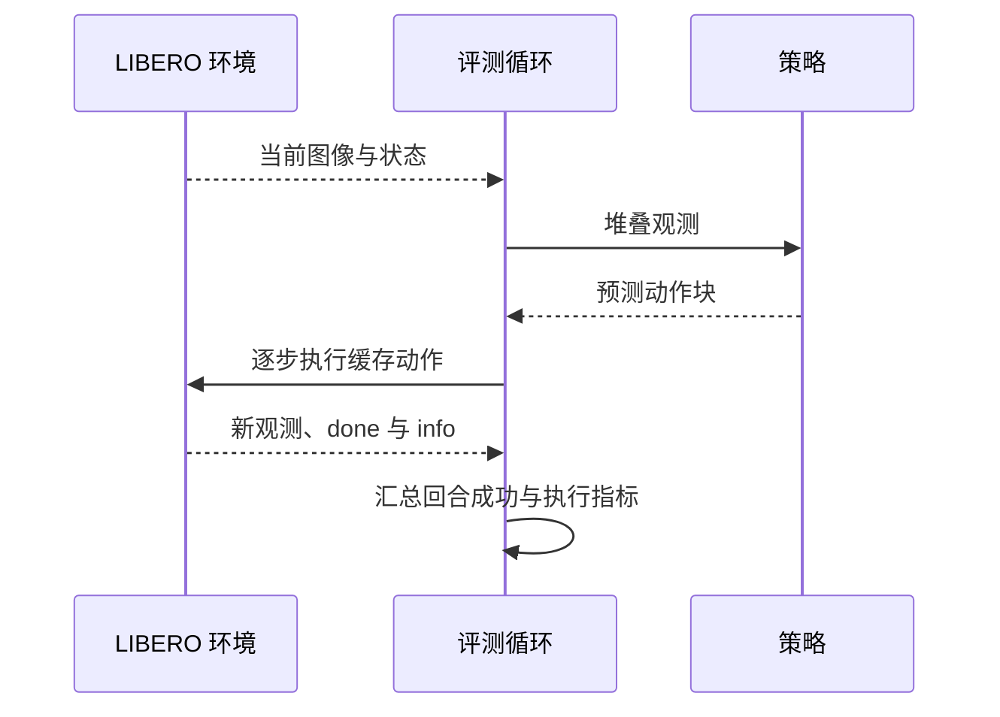

<!-- PAGE_ID: ode-policy_06_libero -->

相关源码

- [libero_env.py](https://github.com/NTUMARS/ODE-POLICY/blob/7482a1fc56332e2c3318ba3eb3d0b92adda9a469/ode_policy/libero/libero_env.py)
- [libero_eval_runner.py](https://github.com/NTUMARS/ODE-POLICY/blob/7482a1fc56332e2c3318ba3eb3d0b92adda9a469/ode_policy/libero/libero_eval_runner.py)
- [eval_ode_policy.py](https://github.com/NTUMARS/ODE-POLICY/blob/7482a1fc56332e2c3318ba3eb3d0b92adda9a469/ode_policy/libero/eval_ode_policy.py)
- [libero_plus_eval_runner.py](https://github.com/NTUMARS/ODE-POLICY/blob/7482a1fc56332e2c3318ba3eb3d0b92adda9a469/ode_policy/libero/libero_plus_eval_runner.py)
- [summarize_eval.py](https://github.com/NTUMARS/ODE-POLICY/blob/7482a1fc56332e2c3318ba3eb3d0b92adda9a469/ode_policy/libero/summarize_eval.py)
- [bench_policy.py](https://github.com/NTUMARS/ODE-POLICY/blob/7482a1fc56332e2c3318ba3eb3d0b92adda9a469/ode_policy/libero/bench_policy.py)

# LIBERO 与 LIBERO-Plus 评测

> **相关页面**：[[安装与复现实验|02_getting_started.md]]、[[数据集与预处理|05_data.md]]

---

<!-- BEGIN:AUTOGEN ode-policy_06_libero_environment -->
## 环境与观测约定

LIBERO 环境封装集中處理 EGL 设备检测、环境构造、观测提取和策略动作转换；评测入口从训练 checkpoint 恢复策略及配置，根据配置决定观测键、相机视图、语言任务嵌入和动作维度。策略输出形状若与 checkpoint 的 `shape_meta` 不一致，会显式报错，避免静默执行错误控制维度。([libero_env.py:39-66](https://github.com/NTUMARS/ODE-POLICY/blob/7482a1fc56332e2c3318ba3eb3d0b92adda9a469/ode_policy/libero/libero_env.py#L39-L66), [libero_env.py:106-178](https://github.com/NTUMARS/ODE-POLICY/blob/7482a1fc56332e2c3318ba3eb3d0b92adda9a469/ode_policy/libero/libero_env.py#L106-L178), [libero_eval_runner.py:314-350](https://github.com/NTUMARS/ODE-POLICY/blob/7482a1fc56332e2c3318ba3eb3d0b92adda9a469/ode_policy/libero/libero_eval_runner.py#L314-L350), [libero_eval_runner.py:278-288](https://github.com/NTUMARS/ODE-POLICY/blob/7482a1fc56332e2c3318ba3eb3d0b92adda9a469/ode_policy/libero/libero_eval_runner.py#L278-L288))

通用 evaluator 为每个任务准备 BDDL 文件，可选择固定初始状态；若指定固定初始状态但任务未提供状态列表，会记录警告并回退随机重置。([libero_eval_runner.py:360-372](https://github.com/NTUMARS/ODE-POLICY/blob/7482a1fc56332e2c3318ba3eb3d0b92adda9a469/ode_policy/libero/libero_eval_runner.py#L360-L372))

Sources: [libero_eval_runner.py:314-350](https://github.com/NTUMARS/ODE-POLICY/blob/7482a1fc56332e2c3318ba3eb3d0b92adda9a469/ode_policy/libero/libero_eval_runner.py#L314-L350), [libero_eval_runner.py:360-372](https://github.com/NTUMARS/ODE-POLICY/blob/7482a1fc56332e2c3318ba3eb3d0b92adda9a469/ode_policy/libero/libero_eval_runner.py#L360-L372)
<!-- END:AUTOGEN ode-policy_06_libero_environment -->

---

<!-- BEGIN:AUTOGEN ode-policy_06_libero_rollout -->
## 策略推理与执行回合

评测循环将最近观测堆叠成策略输入；当动作缓存耗尽时调用 `predict_action` 生成新动作块，然后逐步弹出动作并送入模拟器。回合结束后记录成功状态，ODE 专用入口保留与通用 rollout 相同的基础任务流程，并处理 ODE 策略的动作跟踪细节。([libero_eval_runner.py:220-230](https://github.com/NTUMARS/ODE-POLICY/blob/7482a1fc56332e2c3318ba3eb3d0b92adda9a469/ode_policy/libero/libero_eval_runner.py#L220-L230), [libero_eval_runner.py:265-294](https://github.com/NTUMARS/ODE-POLICY/blob/7482a1fc56332e2c3318ba3eb3d0b92adda9a469/ode_policy/libero/libero_eval_runner.py#L265-L294), [eval_ode_policy.py:1-20](https://github.com/NTUMARS/ODE-POLICY/blob/7482a1fc56332e2c3318ba3eb3d0b92adda9a469/ode_policy/libero/eval_ode_policy.py#L1-L20))

评测脚本默认对四个任务套件逐一运行，ODE checkpoint 与其他策略使用不同 evaluator；结果 JSON 写在 checkpoint 所在目录，且以 checkpoint epoch 命名，避免新评测覆盖旧 epoch 结果。([eval_libero.sh:4-14](https://github.com/NTUMARS/ODE-POLICY/blob/7482a1fc56332e2c3318ba3eb3d0b92adda9a469/scripts/eval_libero.sh#L4-L14), [eval_libero.sh:41-54](https://github.com/NTUMARS/ODE-POLICY/blob/7482a1fc56332e2c3318ba3eb3d0b92adda9a469/scripts/eval_libero.sh#L41-L54), [libero_eval_runner.py:399-409](https://github.com/NTUMARS/ODE-POLICY/blob/7482a1fc56332e2c3318ba3eb3d0b92adda9a469/ode_policy/libero/libero_eval_runner.py#L399-L409))

Sources: [libero_eval_runner.py:220-230](https://github.com/NTUMARS/ODE-POLICY/blob/7482a1fc56332e2c3318ba3eb3d0b92adda9a469/ode_policy/libero/libero_eval_runner.py#L220-L230), [libero_eval_runner.py:265-294](https://github.com/NTUMARS/ODE-POLICY/blob/7482a1fc56332e2c3318ba3eb3d0b92adda9a469/ode_policy/libero/libero_eval_runner.py#L265-L294), [eval_libero.sh:41-54](https://github.com/NTUMARS/ODE-POLICY/blob/7482a1fc56332e2c3318ba3eb3d0b92adda9a469/scripts/eval_libero.sh#L41-L54)
<!-- END:AUTOGEN ode-policy_06_libero_rollout -->

---

<!-- BEGIN:AUTOGEN ode-policy_06_libero_results -->
## 检查点选择与结果汇总

通用评测结果包含每任务成功率和总体平均值，也写入执行统计与 episode 明细；评测 JSON 文件名含任务套件和 checkpoint epoch。批量汇总脚本读取多个 run 下的评测 JSON，按 epoch 与 suite 整理成功率，并可生成 CSV。([libero_eval_runner.py:389-409](https://github.com/NTUMARS/ODE-POLICY/blob/7482a1fc56332e2c3318ba3eb3d0b92adda9a469/ode_policy/libero/libero_eval_runner.py#L389-L409), [summarize_eval.py:1-8](https://github.com/NTUMARS/ODE-POLICY/blob/7482a1fc56332e2c3318ba3eb3d0b92adda9a469/ode_policy/libero/summarize_eval.py#L1-L8), [summarize_eval.py:24-50](https://github.com/NTUMARS/ODE-POLICY/blob/7482a1fc56332e2c3318ba3eb3d0b92adda9a469/ode_policy/libero/summarize_eval.py#L24-L50))

LIBERO-Plus evaluator 按扰动维度筛选任务，输出各维度边际成功率和总体结果；其 JSONL 记录支持断点续跑，因而汇总时需要使用一致的任务抽样参数和 seed 才能公平比较模型。([libero_plus_eval_runner.py:149-185](https://github.com/NTUMARS/ODE-POLICY/blob/7482a1fc56332e2c3318ba3eb3d0b92adda9a469/ode_policy/libero/libero_plus_eval_runner.py#L149-L185), [libero_plus_eval_runner.py:227-239](https://github.com/NTUMARS/ODE-POLICY/blob/7482a1fc56332e2c3318ba3eb3d0b92adda9a469/ode_policy/libero/libero_plus_eval_runner.py#L227-L239), [REPRODUCE.md:148-150](https://github.com/NTUMARS/ODE-POLICY/blob/7482a1fc56332e2c3318ba3eb3d0b92adda9a469/docs/REPRODUCE.md#L148-L150))

`bench_policy.py` 提供基于实际 rollout 的策略评测和固定输入微基准，可分别计时策略调用、图像编码器与 head。([bench_policy.py:53-78](https://github.com/NTUMARS/ODE-POLICY/blob/7482a1fc56332e2c3318ba3eb3d0b92adda9a469/ode_policy/libero/bench_policy.py#L53-L78), [REPRODUCE.md:64-71](https://github.com/NTUMARS/ODE-POLICY/blob/7482a1fc56332e2c3318ba3eb3d0b92adda9a469/docs/REPRODUCE.md#L64-L71))

Sources: [libero_eval_runner.py:389-409](https://github.com/NTUMARS/ODE-POLICY/blob/7482a1fc56332e2c3318ba3eb3d0b92adda9a469/ode_policy/libero/libero_eval_runner.py#L389-L409), [summarize_eval.py:1-8](https://github.com/NTUMARS/ODE-POLICY/blob/7482a1fc56332e2c3318ba3eb3d0b92adda9a469/ode_policy/libero/summarize_eval.py#L1-L8), [libero_plus_eval_runner.py:227-239](https://github.com/NTUMARS/ODE-POLICY/blob/7482a1fc56332e2c3318ba3eb3d0b92adda9a469/ode_policy/libero/libero_plus_eval_runner.py#L227-L239)
<!-- END:AUTOGEN ode-policy_06_libero_results -->

---
